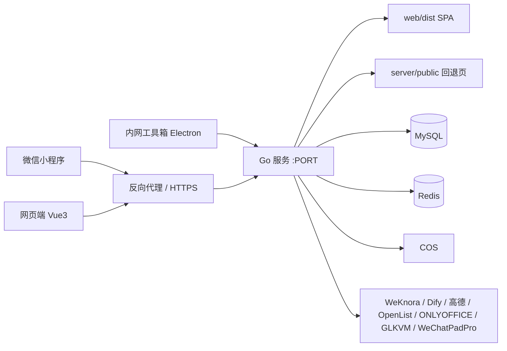

# Shade 壹匣

> 班组数字化工具平台：微信小程序 + 网页端 + 内网桌面客户端，一套登录、一套权限、多个业务应用。

[](https://github.com/zhangzhenyu91/j1toolkit/releases)
[](https://github.com/zhangzhenyu91/j1toolkit/stargazers)
[](https://github.com/zhangzhenyu91/j1toolkit/network)
[](https://github.com/zhangzhenyu91/j1toolkit/commits/main)
[](LICENSE)
[](https://github.com/zhangzhenyu91/j1toolkit/pulls)

[](https://go.dev)
[](https://vuejs.org)
[](https://tdesign.tencent.com)
[](https://developers.weixin.qq.com/miniprogram/dev/framework/)
[](https://www.electronjs.org)
[](https://www.mysql.com)
[](https://redis.io)
[](https://www.docker.com)
[](https://jwt.io)

## 目录

- [项目简介](#项目简介)
- [功能特性](#功能特性)
- [技术栈](#技术栈)
- [系统架构](#系统架构)
- [目录结构](#目录结构)
- [快速开始](#快速开始)
- [部署](#部署)
- [发版](#发版)
- [验证](#验证)
- [文档](#文档)
- [贡献](#贡献)
- [许可证](#许可证)
- [隐私与脱敏](#隐私与脱敏)

## 项目简介

**Shade 壹匣** 是一个面向班组的数字化工具平台。它把日常工作中分散的小工具、台账和流程收进同一套系统：

- **统一入口**：微信小程序、网页端、内网桌面客户端三端共用账号、权限与业务数据。
- **统一权限**：账号密码 / 微信登录，应用级授权，三级角色与班组数据隔离。
- **按应用扩展**：新应用以小分包、网页页面或客户端插件接入，不改动本体骨架。
- **可私有化部署**：Go 单端口服务 + MySQL + Redis，Docker 多架构镜像，配置全部走环境变量与运行配置中心。

项目采用「政企蓝白」设计语言：白卡、发丝线、品牌蓝强调色、克制的状态色与动效，小程序与网页端共用同一套设计 token。

## 功能特性

| 应用                   | 能力                                                                       | 终端            |
| ---------------------- | -------------------------------------------------------------------------- | --------------- |
| 统一登录与权限         | 账号密码 / 微信登录、JWT + Redis 会话、应用授权、三级角色、班组隔离        | 全端            |
| Call Me                | 知识库流式问答：模型切换、联网搜索、思考强度、附件、群内提问直推           | 全端            |
| 出工日志               | 派车/巡视/打卡记录、水印照片工作流验证、备注附件、任务单/费用汇总/派车汇总 | 全端            |
| 安全日活动             | 学习文档合并、工作流生成六段式记录、自定义模板库、在线预览                 | 全端            |
| KVM 远程管理与文件传输 | 设备列表、带态跳转、虚拟 U 盘推送/取回、网盘互通                           | 网页端 / 小程序 |
| 水印添加               | 选片/拍摄 → 裁剪 → 编辑水印 → 服务端渲染短时回图                           | 全端            |
| 题库刷题               | Excel 导入、顺序/随机/错题/收藏、背题模式、答题卡、AI 解析                 | 全端            |
| 商旅打卡               | 账号绑定、两次打卡、费用、照片双向同步、每日核查与提醒                     | 全端            |
| 通知推送               | 站内通知 + 微信个人/班组群外发，系统触发与超管手动推送                     | 全端            |
| 团队网盘               | OpenList 中转、分片上传、移动/复制、压缩包、分享、在线编辑                 | 全端            |
| 树障隐患记录           | 群消息直推、暂存与冲突裁决、统计导出、内网 U 盘同步、知识库快照            | 全端            |
| 交跨记录               | 群消息直推、暂存与冲突裁决、统计导出、内网 U 盘同步、知识库快照            | 全端            |
| 班组数据               | 车牌、目的地、人员、杆塔、运维线路、商旅设备字典                           | 全端            |
| 微信智能应答           | 群消息监听、树障/交跨提取、群内提问、聊天归档                              | 网页管理端      |
| 应用配置与应用日志     | 运行配置中心；文件优先持久日志、trace 串联、健康检查、NDJSON 导出          | 网页管理端      |
| 内网工具箱             | SSO 登录、派车/树障/交跨同步、题库 OCR、轨迹导出、课程学习                 | 内网桌面客户端  |

## 技术栈

| 层       | 选型                                                                     |
| -------- | ------------------------------------------------------------------------ |
| 小程序   | 微信小程序原生 + tdesign-miniprogram                                     |
| 网页端   | Vue 3 + Vite + TDesign Vue Next                                          |
| 后端     | Go 1.27+，chi 路由，database/sql + MySQL，go-redis                       |
| 存储     | MySQL（业务数据）、Redis（会话/黑名单/锁）、腾讯云 COS（文件）           |
| 鉴权     | JWT + Redis 黑名单，网页端短时效 token，小程序微信静默续期               |
| 外部服务 | WeKnora、Dify、GLKVM Cloud、高德地图、OpenList、ONLYOFFICE、WeChatPadPro |
| 客户端   | Electron 33 + Vue 3 + Python sidecar（PyInstaller）                      |
| 部署     | Docker 多架构镜像（amd64/arm64）、docker compose、Nginx 反代             |

## 系统架构



关键设计：

- **单端口同源**：Go 服务同时托管 `/api/v1` 与网页端静态资源，无跨域、无路径前缀。
- **配置分层**：启动必需项读环境变量；业务配置首次缺值导入运行配置中心，敏感项加密存储。
- **数据隔离**：业务表带 `team_id`，后端按生效班组强制过滤；超管可按班组切换。
- **可观测**：请求 trace、访问/审计/业务/出站日志统一落 NDJSON 与数据库，默认永久保留。

## 目录结构

```text
.
├─ miniprogram/            微信小程序（主包 + 各应用分包）
├─ go/                     后端 Go 服务（cmd/shade + internal/apps + internal/httpapi）
├─ web/                    网页端 Vue 3（构建产物 web/dist 由 Go 托管）
├─ server/                 Go 运行素材与原生 HTML/JS 回退页（无 Node 服务端）
├─ uvmp-toolkit/           内网工具箱客户端（Electron + Python sidecar）
├─ design/                 UI 设计稿与设计规范
├─ docker/                 部署包（compose + .env.example + ONLYOFFICE 说明）
├─ .github/workflows/      发版、补跑、main 同步流水线
├─ Dockerfile              服务端多阶段镜像（Go + web 构建 + 运行素材）
├─ .cnb.yml                CNB 国内镜像与 Release 附件接力
├─ 开发指南.md              开发全参考（架构/数据库/接口/应用/部署/踩坑）
├─ AGENTS.md               协作规则、UI token、编码与验证规范
└─ README.md               本文件
```

## 快速开始

### 环境要求

- Go **1.27+**
- Node.js **22+**、npm **10+**
- 微信开发者工具（小程序）
- Python **3.12**（仅内网客户端核心构建）
- 可选：MySQL 8、Redis 7、Docker 24+

### 后端（本地 fixture，无需数据库）

```bash
cd go
SHADE_LOCAL_FIXTURE=1 PORT=3000 go run ./cmd/shade
# 浏览器打开 http://127.0.0.1:3000/
```

fixture 模式使用内存假数据，适合前端联调与接口自检，不连接 MySQL/Redis。

### 后端（连接真实 MySQL/Redis）

```bash
cp docker/.env.example .env      # 按实际填写 JWT_SECRET、MYSQL_*、REDIS_* 等
cd go
go run ./cmd/shade
```

`docker/.env.example` 是全仓唯一的环境变量示例；完整变量说明见 [`开发指南.md` 附录 A](开发指南.md#附录-a环境变量清单)。

### 网页端

```bash
cd web
npm install
npm run dev        # http://127.0.0.1:5173，/api 自动代理到 127.0.0.1:3000
npm run build      # 产出 web/dist，由 Go 服务托管
```

### 微信小程序

1. 微信开发者工具导入 `miniprogram/`；
2. 「工具 → 构建 npm」；
3. 修改 `miniprogram/config.js` 的 `BASE_URL` 为后端地址；
4. 将 `project.config.json` 的 `appid` 替换为真实小程序 AppID；
5. 小程序后台配置 request 合法域名（HTTPS）；出工日志照片需额外配置 COS `downloadFile` 合法域名。

### 内网客户端

```bash
cd uvmp-toolkit
python -m unittest discover -s tests -v
python toolkit/app.py selfcheck
cd desktop && npm ci && node --test test/*.test.mjs test/*.test.cjs && npm run build
```

构建、安装包与平台兼容说明见 [`uvmp-toolkit/内网工具箱开发指南.md`](uvmp-toolkit/内网工具箱开发指南.md)。

## 部署

### Docker Compose

`docker/` 为自包含部署包：

```bash
docker network create j1toolkit          # 首次：配套容器同入此网络
cd docker
cp .env.example .env                     # 填 IMAGE、JWT_SECRET、MYSQL_*、REDIS_* 等
docker compose up -d
```

- 端口内外同号（默认 `3000`）；
- 数据卷 `./data → /app/server/data`；
- 升级：修改 `.env` 的 `IMAGE` 版本号后 `docker compose pull && docker compose up -d`；
- 配套容器（OpenList、ONLYOFFICE 等）由部署者自装并加入 `j1toolkit` 网络，见 `开发指南.md` 第十五/十六章。

镜像发布到以下位置（同一条发版流水线）：

| 仓库       | 用途             |
| ---------- | ---------------- |
| 腾讯云 TCR | 国内正线         |
| GHCR       | GitHub 构建产物  |
| Docker Hub | 海外/备用        |
| CNB 制品库 | CNB 国内构建产物 |

### 反向代理

单端口同源，反代只做域名 → `http://127.0.0.1:3000`：

```nginx
location / {
    proxy_pass http://127.0.0.1:3000;
    proxy_set_header Host $host;
    proxy_set_header X-Forwarded-Proto $scheme;
    proxy_buffering off;          # SSE 必需
    proxy_request_buffering off;  # 网盘分片流式上传（避免反代整片落盘缓冲）
    proxy_read_timeout 300s;      # 长回答
    client_max_body_size 72m;     # 图片/附件上传
}
```

### 环境变量

- 启动必需：`JWT_SECRET`、`MYSQL_*`、`REDIS_*`；`CONFIG_MASTER_KEY` 缺省从 `JWT_SECRET` 派生。
- 常用启动项：`PORT`、`ADMIN_USERNAME` / `ADMIN_PASSWORD`、`SHADE_WEB_DIR`、`SHADE_LOCAL_FIXTURE`。
- 业务配置：`DIFY_*`、`COS_*`、`WEKNORA_*`、`NETDISK_*`、`OO_*`、`GLKVM_*`、`WECHATPADPRO_*` 等，首次启动按缺值导入运行配置中心，之后在管理端「应用配置」维护，保存即时生效。
- 完整清单与逐项语义见 [`开发指南.md` 附录 A](开发指南.md#附录-a环境变量清单) 与 `docker/.env.example`。

## 发版

服务端与内网客户端使用同一条版本线：

```bash
git tag vX.Y.Z
git push origin vX.Y.Z
```

仅验证/发布客户端、不重建服务端镜像时，用 `client-v*` tag：`git tag client-vX.Y.Z && git push origin client-vX.Y.Z`。该通道只跑三客户端 job，不构建服务端、不触发 CNB。

触发 `.github/workflows/release.yml`：

1. `prepare` 解析版本；
2. `release-init` 预建空 Release（仅 tag）；
3. `build-server` 分架构构建 amd64 / arm64 镜像并推 GHCR + Docker Hub；
4. `client-windows` / `client-linux-amd64` / `client-linux-arm64` 构建三平台客户端并直传 Release；
5. `manifest` 合并多架构 manifest；
6. `release-final` 补全 Release 说明并把 tag 回推 CNB，由 CNB 重建国内镜像并接力上传 Release 附件。

发布纪律：tag 定版后不删除、不移动；补跑走 `release-publish.yml` 或下一个 patch 版本。

## 验证

```bash
# 后端
cd go && go test ./... && go vet ./... && go build ./...

# 网页端
cd web && npm run build

# 小程序 / 静态回退页
node --check miniprogram/**/*.js
node --check server/public/assets/*.js

# 内网客户端
cd uvmp-toolkit && python -m unittest discover -s tests -v
python toolkit/app.py selfcheck
cd desktop && node --test test/*.test.mjs test/*.test.cjs && npm run build
```

Go 测试一律 fake/httptest，不连接真实 MySQL/Redis/云端；微信真机、云端容器与外部服务实连以部署后验证为准。

## 文档

| 文档                                                                       | 内容                                                                      |
| -------------------------------------------------------------------------- | ------------------------------------------------------------------------- |
| [`开发指南.md`](开发指南.md)                                               | 架构、数据库、HTTP 接口、应用对接、接入手册、部署运维、踩坑与环境变量附录 |
| [`AGENTS.md`](AGENTS.md)                                                   | 协作规则、技术栈、UI 设计 token、目录约定、编码与验证规范                 |
| [`design/设计规范.md`](design/设计规范.md)                                 | 「政企蓝白」组件级设计细则                                                |
| [`uvmp-toolkit/内网工具箱开发指南.md`](uvmp-toolkit/内网工具箱开发指南.md) | 客户端架构、插件规范、RPC、构建与验证                                     |

## 贡献

1. 先读 `AGENTS.md` 与 `开发指南.md`；
2. 从 `main` 拉分支，保持最小改动；
3. 按语言范围格式化：Go `gofmt`、前端/JSON/Markdown `npx prettier@3 --write .`、Python `ruff format`；
4. 提交前跑完对应验证命令；
5. 提交信息与注释使用简体中文。

## 许可证

[MIT](LICENSE) © 2026 zhangzhenyu91

## 隐私与脱敏

本仓库为公开仓库，文档与示例数据已做脱敏处理：

- 不包含真实单位名称、线路名称、班组人员姓名、内部 IP、真实域名与密钥；
- 示例中的域名统一使用 `example.com`，IP 使用文档保留段；
- 业务密钥、账号、证书只通过环境变量或运行配置中心注入，绝不入仓；
- 不宜公开的逆向分析、历史数据与归档位于私有配套仓，经 git submodule 挂载于 `private/`。
